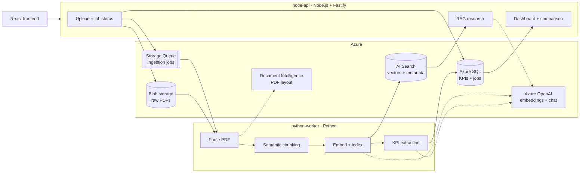

# FinanceAI: AI-Powered Investor Intelligence Platform

FinanceAI turns company annual reports into answers. It ingests the PDFs, extracts key financial metrics into a dashboard, and answers research questions such as *"Why did revenue increase?"* or *"Compare AI investments across companies"*, citing the report pages each answer comes from.

The first dataset is the annual reports of **Apple, Microsoft and Tesla**.

> **Status: in active development.** The architecture, shared contracts and API foundation are in place; the ingestion pipeline and RAG features are being built next. See [Status](#status).

## What it does

| Feature | Description |
| --- | --- |
| **Report ingestion** | Upload an annual report PDF; it is parsed (tables kept intact), split into semantic chunks, embedded and indexed |
| **KPI extraction** | Revenue, net income, operating cash flow, total debt and operating margin, each stored with its source page |
| **Dashboard** | KPI cards per company and documents processed |
| **Company comparison** | Revenue and profit trends across companies, year by year |
| **AI research** | Ask questions in plain English; answers are grounded in retrieved report passages and stream back with citations |

## Architecture



**How a report flows through:**
1. The frontend uploads a PDF. `node-api` saves it to Blob storage, records a job in Azure SQL and puts a message on the queue.
2. `python-worker` picks up the message, parses the PDF with Document Intelligence, splits it into semantic chunks, embeds them and indexes them in AI Search.
3. The worker extracts KPIs with a structured-output prompt, saves them to Azure SQL, and marks the job done.
4. Dashboard and comparison pages read KPIs from Azure SQL through `node-api`.
5. For research, `node-api` embeds the question, runs a hybrid (vector + keyword) search filtered by company and year, and streams a grounded answer with numbered citations.

More detail: [docs/architecture.md](docs/architecture.md).

## Key design decisions

- **Hybrid stack, decoupled through Azure.** Python handles ingestion, where the document and AI tooling is strongest. Node.js and TypeScript handle the API and streaming. The two services never call each other; they share data only through the queue, AI Search and Azure SQL, so each can be built, scaled and deployed on its own.
- **Contracts are the source of truth.** The queue message, KPI record and search-index fields are defined once as JSON Schemas in [`shared/`](shared/), with valid and invalid examples and a contract check that runs in CI.
- **One embedding model.** Indexing (Python) and querying (Node) read the same deployment name from the environment. A mismatch would silently break retrieval.
- **Never invent financial numbers.** A KPI that isn't found is stored as `null`, never guessed, and every value keeps its source page. Research answers must cite retrieved chunks and decline when the context is insufficient.
- **Idempotent ingestion.** Chunk IDs are deterministic (`<document_id>_<chunk_index>`) and KPIs are upserted, so re-ingesting a report overwrites rather than duplicates.
- **Keyless by default.** Every key is optional; when empty, services authenticate with `DefaultAzureCredential` (`az login` locally, workload identity on AKS).

## Tech stack

| Layer | Technologies |
| --- | --- |
| Ingestion worker | Python 3.12, Azure AI Document Intelligence, pymupdf4llm, LangChain, Pydantic, SQLAlchemy |
| API | Node.js 22, TypeScript (strict), Fastify, zod, pino, Vitest |
| Frontend | React, Vite, TypeScript, TanStack Query, Recharts |
| AI and search | Azure OpenAI (embeddings + chat), Azure AI Search (vector + hybrid) |
| Data | Azure SQL, Azure Blob Storage, Azure Storage Queue |
| Infrastructure | Docker, Azure Kubernetes Service (AKS), Bicep, Key Vault, GitHub Actions |

## Repository layout

| Path | Contents |
| --- | --- |
| [`python-worker/`](python-worker/) | Ingestion pipeline: parsing, chunking, indexing, KPI extraction |
| [`node-api/`](node-api/) | Fastify API: uploads, jobs, dashboard, comparison, RAG research |
| [`frontend/`](frontend/) | React app: Dashboard, Comparison, Research and Upload pages |
| [`shared/`](shared/) | Env var template, JSON Schemas, examples, search index fields, contract check |
| [`infra/`](infra/) | Azure provisioning, containers and AKS manifests |
| [`docs/`](docs/) | Architecture and the full task list |

## Status

Work is tracked as GitHub issues **FAI-001 to FAI-040** across five epics. Full list: [docs/FAI-tasks.md](docs/FAI-tasks.md).

| Epic | Scope | Progress |
| --- | --- | --- |
| 0. Foundation | Monorepo, shared contracts, Azure provisioning, local dev, CI | Monorepo and shared contracts done |
| 1. Python ingestion worker | Parsing, chunking, indexing, KPI extraction, evaluation | Up next |
| 2. Node.js API | Uploads, jobs, dashboard, comparison, RAG research | Project setup done (`/health`, tests, CI) |
| 3. React frontend | Dashboard, Comparison, Research, Upload | Not started |
| 4. Containers and AKS | Dockerfiles, ACR, Kubernetes, workload identity | Not started |

## Getting started

Requirements: Node.js 22, Python 3.12, Docker. Azure is needed only for the AI and search features.

```bash
git clone https://github.com/cython1/FinanceAI.git
cd FinanceAI

# Environment: copy the template and fill in values (never commit .env)
cp shared/.env.example .env

# Shared contracts
pip install -r shared/scripts/requirements.txt
python shared/scripts/check_contracts.py

# Node API
cd node-api
npm ci
npm test
npm run dev          # http://localhost:3000/health
```

## How this project is built

Each task is a scoped GitHub issue with acceptance criteria, dependencies and a branch name. Work is done on `feature/FAI-XXX-*` branches and merged through reviewed pull requests.

Some tasks are delivered with AI coding agents (Claude and GitHub Copilot). They work from the rules in [AGENTS.md](AGENTS.md), look up current Azure and library docs through MCP servers ([`.mcp.json`](.mcp.json)), and every agent pull request is reviewed before merge. See [CONTRIBUTING.md](CONTRIBUTING.md) to pick up a task.
