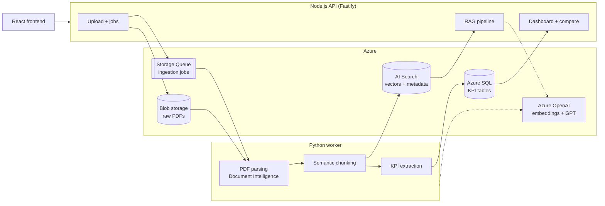

# Architecture

## Request flows

**Ingestion:** the frontend uploads a PDF → Node API stores it in Blob storage, records a job in Azure SQL and puts a message on the queue → the Python worker picks up the message, parses, chunks, embeds and indexes the report, extracts KPIs, saves them to Azure SQL and marks the job done.

**Dashboard and comparison:** the frontend calls the Node API, which reads KPIs from Azure SQL.

**Research:** the frontend sends a question → Node embeds it, runs a hybrid search in AI Search with company/year filters, builds a grounded prompt, and streams the GPT answer back with citations.

## Deployment

Three containers (`python-worker`, `node-api`, `frontend`) run on AKS. Images are built to Azure Container Registry; secrets come from Key Vault and Azure access uses workload identity.
